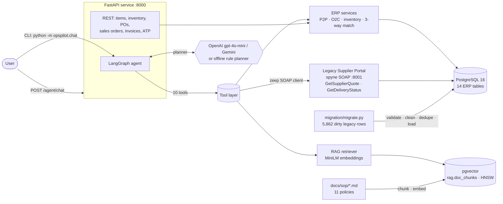
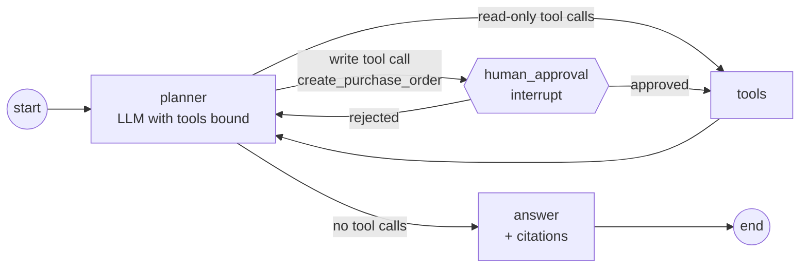
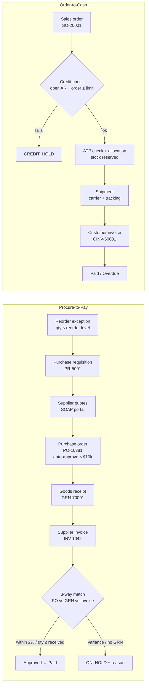

# OpsPilot – Agentic AI Copilot for ERP & Supply Chain

[](https://github.com/atharv1183/opspilot/actions/workflows/ci.yml)


**OpsPilot is an AI agent that answers questions and performs actions on a mock ERP.** It covers
procurement, inventory and order management. Ask *"Which items are below reorder level in
Warehouse B? Draft POs for them from the cheapest approved supplier"* and it finds the reorder
exceptions, raises requisitions, pulls live quotes from a legacy **SOAP** supplier portal, and
**pauses for human approval** before committing spend. Ask *"Why is invoice INV-1042 on hold?"*
and it runs a **3-way match** (PO vs goods receipt vs invoice) and explains the +6.5% price
variance. Policy answers come from the company's SOP library via **RAG**, with citations.
Underneath is a 14-table ERP schema that models real **Procure-to-Pay** and **Order-to-Cash**
flows. It is loaded by a **legacy data migration** of 5,862 deliberately dirty records. The
system is exposed through **FastAPI + SOAP** integrations and measured by a **50-query
evaluation harness**.

---

## Demo

> 🎬 **Demo GIF placeholder.** Record one and drop it at `docs/demo.gif`, then replace this
> block with ``.
>
> How to record (about 60 seconds):
> 1. `docker compose up -d --build`, then wait for `docker compose ps` to show `api` as healthy.
> 2. Start a recorder: [ScreenToGif](https://www.screentogif.com/) (Windows), [Kap](https://getkap.co/) (macOS)
>    or `peek` (Linux). For a terminal-only GIF use [`vhs`](https://github.com/charmbracelet/vhs) or `asciinema` + `agg`.
> 3. Run `docker compose exec api python -m opspilot.chat` and type:
>    - `Why is invoice INV-1042 on hold?`
>    - `Which items are below reorder level in Warehouse B, and draft POs for them from the cheapest approved supplier`
>      and answer `y` at the approval prompt.
> 4. Optional: show `http://localhost:8000/docs` and the `POST /agent/chat` call.
> 5. Export below 10 MB (800px wide, 10–12 fps).

---

## Architecture



### Agent graph (LangGraph)



* **Planner → tools → planner loop.** The planner either calls tools or produces the answer,
  with a tool-round budget.
* **Human-in-the-loop.** Any write action (`create_purchase_order`) triggers LangGraph's
  `interrupt()`. The run is checkpointed and resumes with `Command(resume={"approved": ...})`,
  from the API (`{"thread_id", "approve": true}`) or the CLI (`approve? [y/N]`). The approval
  card shows supplier, unit price, total, and whether the PO will be auto-approved under the
  $10k limit.
* **Memory.** A checkpointer keyed by `thread_id` keeps the conversation, so *"What about
  warehouse D?"* works as a follow-up.
* **Planner backends.** OpenAI `gpt-4o-mini` (or any OpenAI-compatible endpoint, such as
  Ollama), Google Gemini, or a deterministic **offline rule planner**. The offline planner lets
  the whole system, CI and the eval run without an API key. Every eval result states which
  planner produced it.

### Business flows modelled



---

## Features

| Area | What's implemented |
|---|---|
| **ERP data model** | Exactly 14 business tables: `suppliers, customers, items, warehouses, inventory, purchase_requisitions, purchase_orders, po_lines, goods_receipts, supplier_invoices, sales_orders, so_lines, shipments, customer_invoices`. Native Postgres status enums, FKs, audit timestamps, Alembic migrations. RAG chunks live in a separate `rag.doc_chunks` table. |
| **Legacy data migration** | Faker generator (fixed seed) for **5,862** dirty legacy rows: duplicate suppliers, 5 date formats, free-text units, missing fields, orphan references. `migration/migrate.py` runs extract → pydantic validate → clean → de-duplicate → map FKs → **single-transaction load** → [reconciliation report](migration/report.md). |
| **REST integration** | FastAPI CRUD and actions for items, inventory (cycle-count adjustments, low stock, ATP), requisitions, POs (create, approve, cancel), goods receipts, sales orders (with credit check), and AP/AR invoices with 3-way match. OpenAPI docs at `/docs`. |
| **SOAP integration** | spyne SOAP 1.1 "Supplier Portal" (`GetSupplierQuote`, `GetDeliveryStatus`, WSDL at `:8001/?wsdl`). The agent calls it through a **zeep** client, which maps SOAP faults to business errors. REST→SOAP bridge endpoints are also exposed. |
| **Agent (10 tools)** | `get_inventory_level`, `find_low_stock_items`, `create_purchase_requisition`, `create_purchase_order` *(approval required)*, `get_po_status` *(+ SOAP delivery tracking)*, `three_way_match`, `get_sales_order_status`, `check_available_to_promise`, `get_supplier_quote` *(SOAP)*, `search_sop_docs` *(RAG)* |
| **Business rules in code** | Only APPROVED suppliers can get POs. Cheapest *approved* quote wins, so a cheaper PENDING or BLOCKED supplier is skipped. POs ≤ $10k auto-approve, larger ones go to PENDING_APPROVAL. 3-way match uses a 2% adverse price tolerance and 0% quantity tolerance, with precedence NO_RECEIPT > QTY > PRICE. ATP = on hand − reserved + open PO receipts by date. Credit hold when open AR + order > limit. Replenishment skips items already covered by open POs. |
| **RAG** | 11 SOP/policy docs (procurement, approval limits, 3-way match tolerance, returns, cycle count, supplier onboarding, replenishment, credit, ATP, goods receipt, master data). Heading-aware chunking, local `all-MiniLM-L6-v2` embeddings (OpenAI optional), pgvector HNSW cosine top-k, answers cite `[doc.md]`. |
| **Evaluation** | 50 queries with expected tools, key facts and source docs. Measures tool-selection accuracy, answer correctness (key facts + optional LLM-as-judge), retrieval hit@3, approval compliance and latency. |
| **Engineering** | docker-compose (pgvector, API, SOAP), Makefile, 78 pytest tests on a real Postgres test DB, GitHub Actions (ruff, pytest with a Postgres service container, eval smoke test), type hints and docstrings, `src/` layout. |

---

## Quickstart

Prerequisites: Docker. An LLM key is optional; without one, the agent uses the offline planner.

```bash
git clone https://github.com/atharv1183/opspilot.git && cd opspilot
cp .env.example .env            # optional: set OPENAI_API_KEY or GOOGLE_API_KEY
docker compose up -d --build    # postgres+pgvector, SOAP service, API (first start loads data, ~2 min)
docker compose exec api python -m opspilot.chat
```

* API docs: <http://localhost:8000/docs> · SOAP WSDL: <http://localhost:8001/?wsdl>
* On first start the API container runs `alembic upgrade head`, then the legacy migration, the
  demo seed and the SOP embedding.
* With `make`: `make up`, `make migrate`, `make seed`, `make test`, `make eval`, `make chat`.
* Port clash? Set `API_HOST_PORT`, `SOAP_HOST_PORT` or `POSTGRES_HOST_PORT` in `.env`.
* Local LLM: set `OPENAI_BASE_URL=http://host.docker.internal:11434/v1`,
  `OPENAI_MODEL=qwen2.5:7b` and `OPENAI_API_KEY=ollama` to use Ollama through its
  OpenAI-compatible API.

---

## Example conversations

<!-- EXAMPLES -->

---

## Evaluation results

<!-- EVAL -->

---

## Data migration report (summary)

<!-- MIGRATION -->

---

## Tech stack

| Layer | Technology |
|---|---|
| Language | Python 3.11, type hints throughout |
| Agent | LangGraph (StateGraph, `interrupt()` human-in-the-loop, checkpointer memory), LangChain tools |
| LLM | OpenAI `gpt-4o-mini` or Google Gemini (configurable in `.env`); offline rule planner fallback |
| API | FastAPI + Uvicorn, pydantic v2, OpenAPI |
| Legacy integration | spyne (SOAP 1.1 server + WSDL), zeep (SOAP client) |
| Data | PostgreSQL 16, pgvector (HNSW, cosine), SQLAlchemy 2.0, Alembic |
| Embeddings | sentence-transformers `all-MiniLM-L6-v2` (local, default) or OpenAI `text-embedding-3-small` |
| Migration | Faker (seeded), pydantic validation, transactional load, Markdown reconciliation |
| Quality | pytest (78 tests), ruff (lint + format), GitHub Actions, Docker / docker-compose |

## Project layout

```
src/opspilot/
  db/            models (14 ERP tables + rag.doc_chunks), enums, session
  erp/           business logic: p2p.py (requisition, PO, GRN, 3-way match), o2c.py, inventory.py (ATP)
  api/           FastAPI app + routers (items, inventory, purchasing, sales, invoices, agent)
  soap/          spyne Supplier Portal service + zeep client
  rag/           chunking, embeddings, ingest, retriever
  agent/         tools.py (10 tools), graph.py (LangGraph), llm.py, offline.py, service.py
  chat.py        terminal chat · seed.py demo transactions · bootstrap.py first-run loader
migration/       generate_legacy.py, cleaning.py, schemas.py, migrate.py, legacy/*.csv, report.md
alembic/         0001 ERP schema, 0002 RAG schema
docs/sop/        11 SOP / policy documents
eval/            queries.yaml (50), run_eval.py, results.md
tests/           78 tests (cleaning, migration, 3-way match, tools, API, agent, RAG, SOAP)
```

## Running without Docker

```bash
docker compose up -d db                          # or any Postgres 16 with pgvector
python -m venv .venv && source .venv/bin/activate
pip install --index-url https://download.pytorch.org/whl/cpu torch && pip install -e ".[dev]"
alembic upgrade head && python -m opspilot.bootstrap
python -m opspilot.soap.service &                # SOAP portal on :8001
uvicorn opspilot.api.main:app --reload           # API on :8000
pytest                                           # uses the opspilot_test database
```

---

## What I learned

* **ERP processes come first, AI second.** Most of the value comes from encoding the business
  rules correctly: approved suppliers only, approval limits, 3-way match tolerances and their
  precedence, ATP, credit exposure. The agent can then explain *why* something happened instead
  of guessing.
* **Write actions need hard guardrails, not prompt instructions.** Approval is enforced in the
  graph (`interrupt()` before any write tool), not in the prompt. It also survives restarts
  through the checkpointer and is checked by the eval.
* **Data migration is mostly reconciliation.** De-duplicating suppliers by tax ID and name,
  re-pointing POs that referenced a duplicate vendor number, and proving
  `read = loaded + merged + rejected` for every file mattered more than the load itself.
* **Measure, don't vibe.** The eval harness exposed real issues. Metadata-only "preamble"
  chunks hurt retrieval, one expected fact of mine was wrong, and a 1.5B local model skips
  tools and hallucinates. Each run states its planner so the numbers stay honest.
* **Legacy integration is a first-class concern.** Wrapping the SOAP portal behind a typed zeep
  client with fault mapping kept the agent tools simple and testable against a real in-process
  spyne server.

## Future work

* Run and publish the eval with `gpt-4o-mini` and Gemini, and add LLM-as-judge numbers.
* Persist agent memory with `langgraph-checkpoint-postgres` instead of the in-memory saver.
* Role-based approvals (approval limits per user) and an audit log table for agent actions.
* Streaming responses (SSE) and a small web UI with an approval inbox.
* Hybrid retrieval (BM25 + vectors) and a re-ranker, since keyword-heavy policy questions still
  miss.
* Incremental (delta) migration with CDC, and an outbound IDoc/EDI-style integration.

## License

MIT, see [LICENSE](LICENSE).
